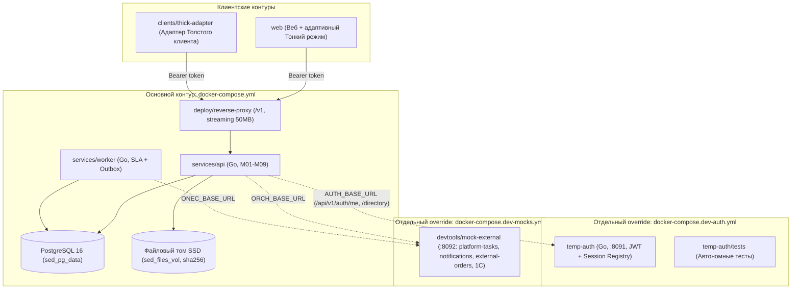

# Поэтапная схема создания Сервиса электронного документооборота (СЭД)

Настоящая дорожная карта описывает последовательное создание Сервиса СЭД на стеке **Go (`chi` + `pgx/v5` + `goose`) + PostgreSQL 16 + React/TypeScript** в Docker-инфраструктуре с жёстким разделением контуров, изолированным временным сервисом аутентификации (`temp-auth`) и тестовыми воротами на каждом этапе.

## Архитектурная схема контуров

---

## Этап 0. Инфраструктурный стенд, защита секретов и отдельный `temp-auth`

**Цель:** подготовить воспроизводимую Docker-среду, многослойную защиту от утечек и полностью изолированный временный сервис аутентификации, который заменяется на боевую платформу простым переключением `AUTH_BASE_URL`.

1. **Защита от секретов и утечек:**
   - `.gitignore`, `.dockerignore`, `.env.example`.
   - `scripts/secret_guard.go` + `.githooks/pre-commit` + `.github/workflows/ci-and-secrets.yml` (`gitleaks` + аудит).
2. **Docker-инфраструктура:**
   - `docker-compose.yml` — `postgres` (`sed_pg_data`), `api`, `worker`, `reverse-proxy` (без `temp-auth`).
   - `docker-compose.dev-auth.yml` — поднимает `temp-auth` как отдельный контейнер и передаёт `AUTH_BASE_URL=http://temp-auth:8091`.
   - `docker-compose.dev-mocks.yml` — поднимает `devtools/mock-external` (отдельно от `temp-auth`) для эмуляции `platform-tasks`, `notifications`, `external-orders` и шлюза 1С (с режимом отказа 1С).
3. **Изолированный `temp-auth/`:**
   - Собственный `go.mod`, `Dockerfile` и `temp-auth/tests/`.
   - Выдача JWT + серверный реестр активных сессий и блокировок.
   - Каталог тестовых пользователей двух юрлиц (`ORG-01`, `ORG-02`), иерархии руководителей и всех 9 ролей.
   - Эндпоинты: `GET /api/v1/auth/me`, `GET /api/v1/auth/directory`, `POST /dev/token`, `POST /dev/sessions/{jti}/revoke`, `POST /dev/users/{id}/block`, `POST /dev/users/{id}/unblock`.
4. **Ворота этапа (Definition of Done):**
   - `temp-auth/tests` проходит на 100% (включая мгновенный отзыв токена `401`).
   - `verify_compliance.go` и `secret_guard.go` возвращают `0`.

---

## Этап 1. Серверное ядро, БД PostgreSQL, безопасность `M08`, картотека `M01` и файлы `M02`

**Цель:** развернуть изолированное хранилище карточек, файлов и аудит с серверной авторизацией Zero-Trust.

1. **БД и миграции (`goose`):**
   - Таблицы по ERD: `document_types`, `registration_journals`, `documents`, `document_versions`, `files`, `document_links`, `routes`, `route_steps`, `step_tasks`, `assignments`, `assignment_executors`, `deputies`, `access_rights`, `access_requests`, `case_nomenclature`, `tags`, `document_tags`, `calendar_events`, `comments_reviews`, `paper_movements`, `counterparties`, `audit_log`, `outbox_events`, `idempotency_keys`.
   - Триггер/правило PostgreSQL, запрещающее `UPDATE` и `DELETE` на `audit_log`.
   - Уникальные индексы: `(organization_code, journal_id, reg_year, reg_number)` и `(from_document_id, to_document_id, link_type)`.
2. **Модуль `M08` (Zero-Trust и изоляция):**
   - Middleware проверки Bearer-токена через `AUTH_BASE_URL/api/v1/auth/me` (никаких паролей в СЭД).
   - Проверка прав чтения/изменения/скачивания на сервере с изоляцией `organization_code`.
   - Заявки на доступ и временный доступ «Дополнительные пользователи» (`expires_at`, `granted_by`).
   - Обязательное логирование в `audit_log` событий `просмотр`, `файл`, `право`, `переход`, `решение`, `поручение`, `важность`.
3. **Модули `M01` и `M02`:**
   - `POST /v1/documents`, `GET /v1/documents/{id}`, `PATCH /v1/documents/{id}`, `POST /v1/documents/{id}/comments` с обязательным `Idempotency-Key` для создания.
   - Потоковый приём и выдача файлов до 50 МБ (`POST /v1/files`, `GET /v1/files/{id}`), расчёт `sha256`, дедупликация на томе, раскладка `YYYY/MM/sha256[0..1]/sha256`, шардирование `shard_volume = hash(document_id) mod N` (старт с `0`).
   - Автоматический выпуск версии `N+1` при изменении состава файлов после старта маршрута.
4. **Ворота этапа:**
   - Контрактные и интеграционные тесты в `tests/api-v1/`, `tests/reverse-proxy/`, `tests/orchestrator-gateway/` (покрытие `AC-02`, `AC-10`, `AC-11`).

---

## Этап 2. Универсальный движок маршрутов `M03`, резолюции `M04`, SLA/замещения `M05` и Outbox 1С

**Цель:** реализовать полный жизненный цикл документов на универсальном движке без привязки кода к названиям видов.

1. **Движок `M03`:**
   - Клонирование шаблона (`is_template = true`) в экземпляр (`is_template = false`).
   - Машина из 9 состояний карточки + режим паузы `Приостановлено` на экземпляре маршрута.
   - 7 примитивов шагов (`resolution`, `review`, `approval`, `signing`, `registration`, `execution`, `acknowledgment`).
   - Флаги `join_mode`, `stop_on_reject`, `allow_early_sign`, `per_file_approval`, `is_mandatory`, `is_order_locked`, `condition_rule`.
   - Делегирование, добавление участника без сброса `plan_due_at`, пауза подчинённых карточек при возврате/отзыве родителя, боковая рецензия без SLA.
   - Выгрузка листа согласования в `.docx` (с графическим факсимиле при наличии).
2. **Нумерация и Outbox (`M01` + `M09` + `services/worker`):**
   - `POST /v1/documents/{id}/register` (идемпотентно, поэтапное дозаполнение пустых полей без смены номера, транзакционная запись в `outbox_events`).
   - Фоновый воркер экспоненциальной доставки `outbox_events` в 1С и периодической синхронизации справочника контрагентов (`onec_ref`, `name`, `inn`).
3. **SLA и замещения (`M05`):**
   - Производственный календарь (`1 раб. день = 8 раб. часов`), приоритет норм, шкала важности (`Обычная`, `Повышенная`, `Немедленная = 4 ч`), очередь `Срочные` (`<= 16 ч`).
   - Серверный реестр замещений (назначается для новых задач «за кого», не переписывает уже выданные).
4. **Декларативные шаблоны 1-й очереди:**
   - Сидирование 9 видов документов в БД без хардкода в движке.
5. **Ворота этапа:**
   - Тесты в `tests/worker/`, `tests/onec-outbox/`, `tests/api-v1/` (покрытие `AC-03`–`AC-09`, `AC-12`).

---

## Этап 3. Номенклатура дел `M06`, поиск и отчёты `M07`, сквозная интеграция `M09`

1. **Номенклатура дел `M06`:**
   - Справочник дел, опись, `POST /v1/documents/{id}/close-case` с блокировкой любых изменений карточки после закрытия всех поручений.
2. **Поиск, очереди и отчёты `M07`:**
   - Курсорная пагинация (`limit <= 100`, непрозрачный `cursor`).
   - Полнотекстовый, атрибутивный и многотеговый поиск (глобальные и локальные теги подразделения с фильтрацией прав на сервере до нарезки страницы).
   - Плитки `Новые`, `Срочные`, `На контроле`, календарь документов и свободных событий, отчёты SLA.
3. **Сквозная интеграция `M09`:**
   - Синхронизация поручений с `POST /api/v1/platform-tasks` (закрывает только автор), отправка уведомлений в `POST /api/v1/notifications` с `source_document_id`, однократное создание `external_orders` при подписании договора с `customer_contract = true`.
4. **Ворота этапа:**
   - Полные интеграционные тесты `tests/api-v1/` и `tests/orchestrator-gateway/`.

---

## Этап 4. Клиентские режимы и приёмо-сдаточные испытания `AC-01`–`AC-12`

1. **Веб-клиент и Тонкий режим (`web/`):**
   - Единое React/TypeScript-приложение с адаптивным Тонким режимом (без локальной БД/кэша, только 5 очередей, потоковый просмотр и действия в 1 клик).
   - Dashboard руководителя, журналы, карточка документа, конструктор маршрутов, календарь, поиск, отчёты и администрирование.
2. **Адаптер Толстого клиента (`clients/thick-adapter/`):**
   - Типизированный SDK/клиент для встраивания в настольную оболочку Оркестратора поверх `/v1` с поддержкой пакетной загрузки файлов.
3. **Ворота этапа:**
   - Тесты в `tests/web-client/`, `tests/thin-client/`, `tests/thick-client/` и полный сквозной прогон `tests/acceptance-ac/` (`AC-01`–`AC-12`).

---

## Этап 5. Миграция и очередь развития (без переделки ядра)

1. Перенос активных черновиков 1-й очереди в БД Сервиса СЭД.
2. Подключение 6 видов развития (`Дополнительное соглашение`, `Внутренний документ (ЛНА)`, `ТЗ`, `ТКП`, `Счёт`, `Акт`) декларативными шаблонами.
3. Опциональное развёртывание MCP-шлюза поверх `/v1` в рамках сессии и прав `M08`.
